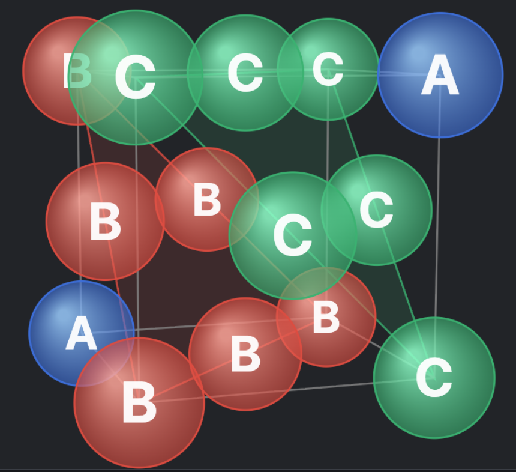

# Face-centered cubic (FCC) crystal structure: ABC stacking

A cubic view of a face-centered cubic (FCC) crystal structure. The A, B and C labels indicate the three positions in the repeating ABCABC stacking sequence of close-packed layers, also called cubic close packing (CCP).

[Download the PNG](face-centered-cubic-abc-stacking-cubic-view.png)
